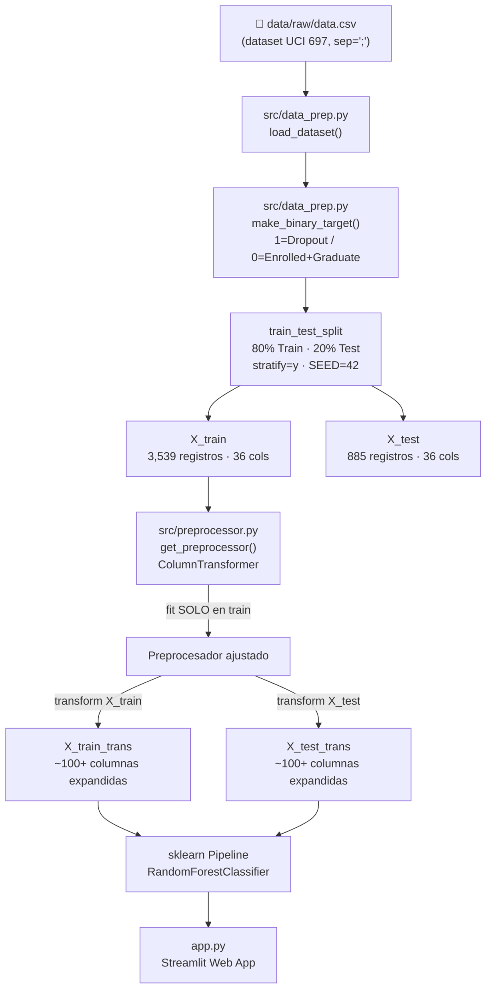

# Análisis Técnico — Predicción de Deserción Universitaria

> [!NOTE]
> Dataset UCI #697 · **4,424 estudiantes** · 36 variables predictoras · Proyecto académico UPN (Sistemas Inteligentes)

---

## 1. Arquitectura de la Solución



---

## 2. Flujo del Proceso (paso a paso)

| Paso | Módulo / Archivo | Acción |
|------|-----------------|--------|
| **1** | [`src/config.py`](file:///c:/repo%20MachineLearning/Proyecto-MachineLearning/src/config.py) | Define constantes globales: rutas, `SEED=42`, `TEST_SIZE=0.20`, métrica objetivo |
| **2** | [`src/data_prep.py`](file:///c:/repo%20MachineLearning/Proyecto-MachineLearning/src/data_prep.py) · `load_dataset()` | Lee `data/raw/data.csv` con `sep=';'`; si no existe, lo descarga de UCI con `ucimlrepo`. Limpia espacios en columnas |
| **3** | [`src/data_prep.py`](file:///c:/repo%20MachineLearning/Proyecto-MachineLearning/src/data_prep.py) · `make_binary_target()` | Binariza target: `1 = Dropout`, `0 = Enrolled + Graduate` |
| **4** | [`src/data_prep.py`](file:///c:/repo%20MachineLearning/Proyecto-MachineLearning/src/data_prep.py) · `split_data()` | Split estratificado 80/20. Train: 3,539 · Test: 885. Verifica proporción Dropout ≈ 32% en ambos sets |
| **5** | [`notebooks/01_p2_preprocesamiento.ipynb`](file:///c:/repo%20MachineLearning/Proyecto-MachineLearning/notebooks/01_p2_preprocesamiento.ipynb) | EDA: confirma **0 nulos** y **0 duplicados**. Clasifica las 36 variables. Construye diccionario |
| **6** | [`src/preprocessor.py`](file:///c:/repo%20MachineLearning/Proyecto-MachineLearning/src/preprocessor.py) · `get_preprocessor()` | Crea `ColumnTransformer`. Se ajusta (`fit`) **exclusivamente en X_train** para evitar *data leakage* |
| **7** | [`app.py`](file:///c:/repo%20MachineLearning/Proyecto-MachineLearning/app.py) · `train_model()` | Ensambla `Pipeline(preprocessor + classifier)`, entrena y evalúa sobre el test set |
| **8** | [`app.py`](file:///c:/repo%20MachineLearning/Proyecto-MachineLearning/app.py) | Interfaz Streamlit con 4 vistas: Simulador, EDA Dashboard, Diccionario, Métricas |

---

## 3. Librerías Utilizadas

| Librería | Versión | Rol en el proyecto |
|----------|---------|-------------------|
| `pandas` | latest | Carga, limpieza y manipulación del dataset CSV |
| `numpy` | latest | Operaciones matriciales y validaciones numéricas |
| `scikit-learn` | latest | Preprocesador (`ColumnTransformer`), modelo (`RandomForestClassifier`), métricas y `Pipeline` |
| `matplotlib` | latest | Gráficos de distribución de clases y matriz de confusión |
| `seaborn` | latest | Visualizaciones estadísticas adicionales (importado, disponible) |
| `ucimlrepo` | latest | Descarga automática del dataset UCI #697 si no existe localmente |
| `streamlit` | latest | Aplicación web interactiva para el simulador y dashboard |

> [!TIP]
> No se especifican versiones en `requirements.txt`. Para reproducibilidad en producción se recomienda fijarlas con `pip freeze`.

---

## 4. Modelo Implementado

### Algoritmo: `RandomForestClassifier` (scikit-learn)

El modelo se encapsula dentro de un **sklearn `Pipeline`** junto al preprocesador:

```python
Pipeline([
    ("preprocessor", get_preprocessor()),   # ColumnTransformer
    ("classifier",   RandomForestClassifier(
        n_estimators  = 100,
        random_state  = 42,       # SEED del proyecto
        class_weight  = "balanced",
        n_jobs        = -1        # usa todos los núcleos
    ))
])
```

**¿Por qué Random Forest?**
- Robusto con variables de naturaleza mixta (nominal + binaria + numérica)
- Tolera correlaciones entre features sin deterioro importante
- `class_weight="balanced"` compensa el desbalance de clases (≈32% Dropout vs 68% resto)
- Genera probabilidades calibradas para el simulador de riesgo

---

## 5. Hiperparámetros del Modelo

| Hiperparámetro | Valor | Justificación |
|----------------|-------|---------------|
| `n_estimators` | **100** | 100 árboles de decisión en el ensemble |
| `random_state` | **42** | Semilla fija del proyecto (reproducibilidad total) |
| `class_weight` | **`"balanced"`** | Pondera inversamente la frecuencia de cada clase para compensar el desbalance Dropout/Resto |
| `n_jobs` | **-1** | Paraleliza el entrenamiento usando todos los núcleos disponibles |
| `max_features` | *(default: `"sqrt"`)* | scikit-learn usa √n_features por árbol por defecto |
| `max_depth` | *(default: `None`)* | Árboles sin poda; crecen hasta hojas puras |
| `min_samples_split` | *(default: `2`)* | Mínimo de muestras para dividir un nodo |
| `min_samples_leaf` | *(default: `1`)* | Mínimo de muestras en cada hoja |

> [!IMPORTANT]
> Los hiperparámetros no han sido optimizados con GridSearch/RandomSearch. Los valores son los **defaults de sklearn** excepto `n_estimators=100`, `class_weight="balanced"` y `random_state=42`.

---

## 6. Preprocesador — ColumnTransformer

El `ColumnTransformer` aplica transformaciones diferenciadas por tipo de variable:

| Transformación | Variables | Cantidad | Detalle |
|---------------|-----------|----------|---------|
| `OneHotEncoder` | Nominales | **9** | `handle_unknown='ignore'`, `sparse_output=False` |
| `Passthrough` | Binarias | **8** | Ya codificadas 0/1, se conservan sin cambios |
| `StandardScaler` | Numéricas | **19** | Media = 0, Desviación estándar = 1 |

**Resultado:** Las 36 columnas originales se expanden a **~100+ columnas** tras el One-Hot Encoding de las 9 nominales.

---

## 7. Umbrales de Clasificación (Simulador)

| Umbral de Probabilidad | Categoría de Riesgo |
|------------------------|---------------------|
| ≥ 60% | 🚨 Riesgo Alto (Crítico) |
| 35% – 59% | ⚠️ Riesgo Moderado |
| < 35% | ✅ Riesgo Bajo |

**Métrica objetivo del proyecto:** F1-Score > 0.78 (clase Dropout)
